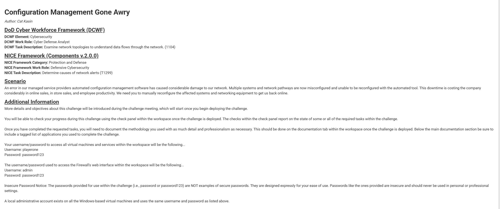
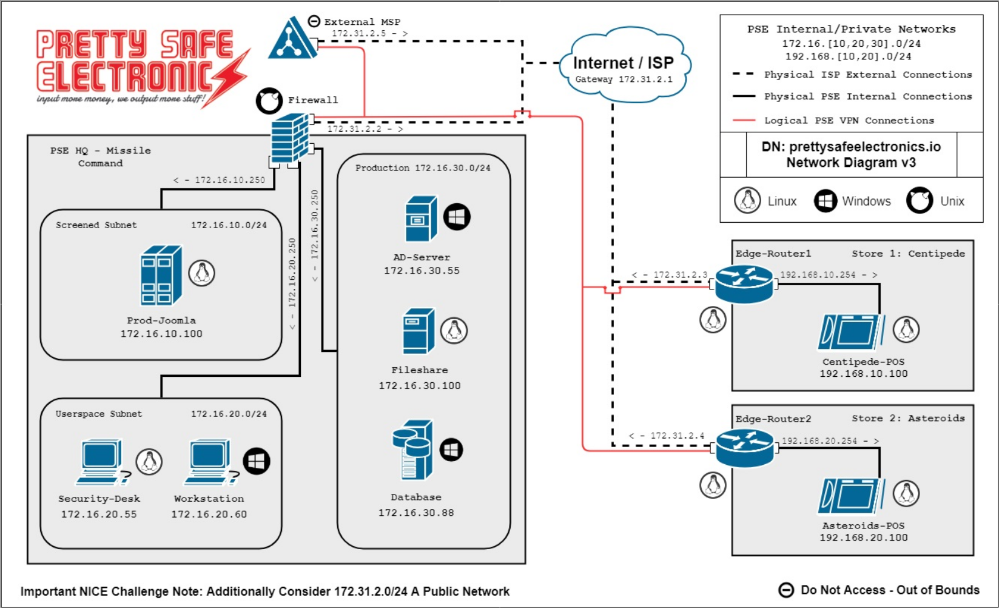
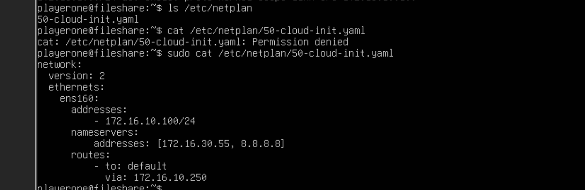
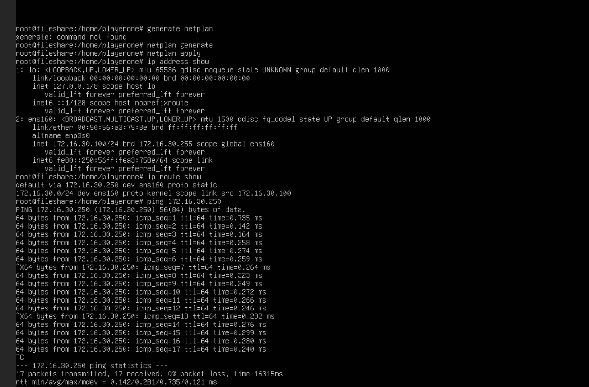
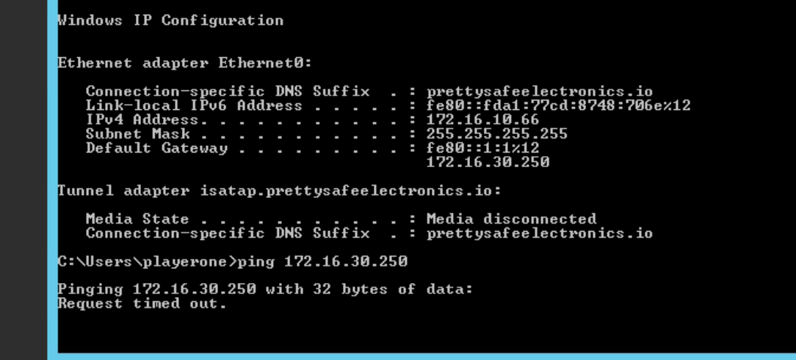
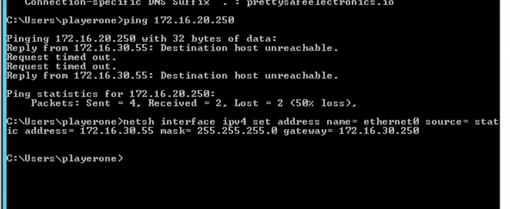
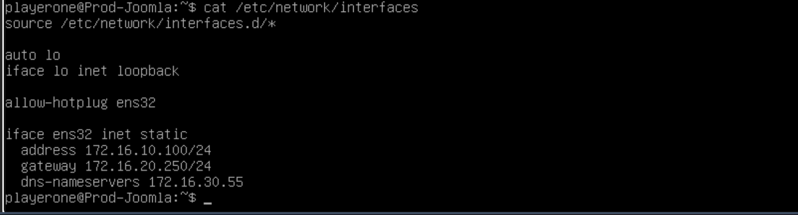
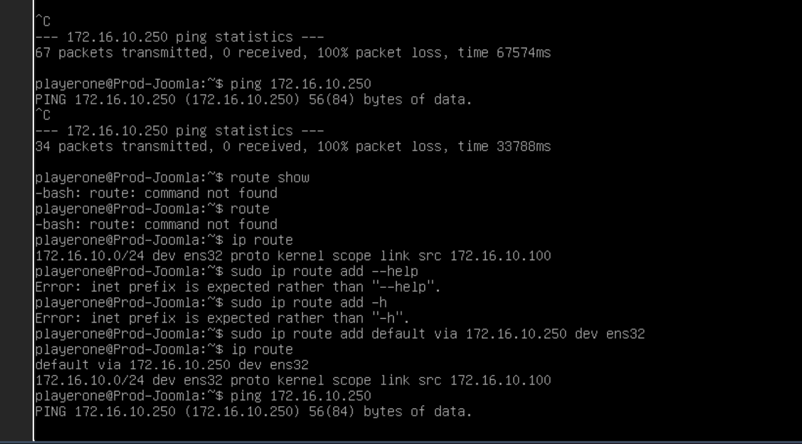
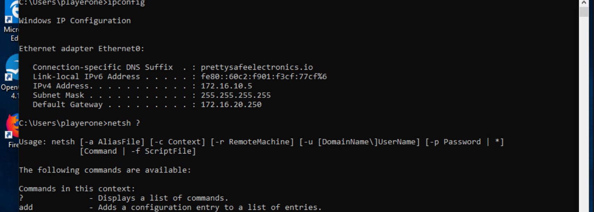
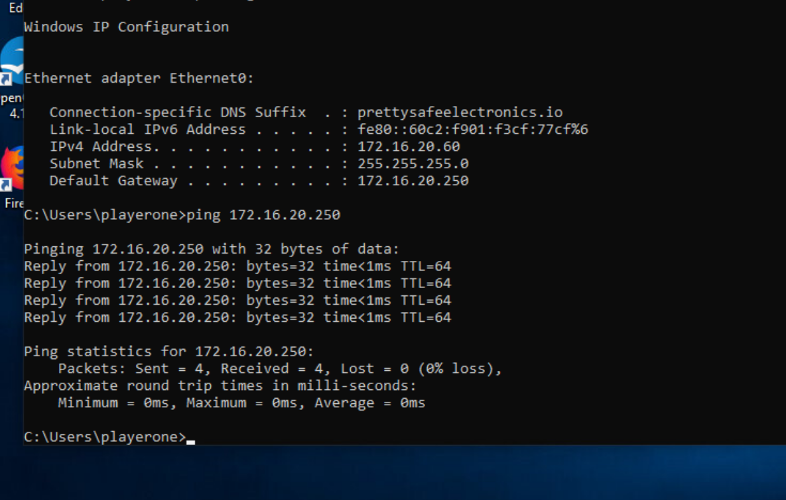

# Cross-Platform Network Troubleshooting Lab

**Windows & Linux | TCP/IP | Network Configuration | Routing | Connectivity Troubleshooting**

## Project Overview

This project documents my completion of the **Configuration Management Gone Awry** challenge in XP Cyber Range. The lab simulated an enterprise network outage caused by an automated configuration management failure.

I investigated and corrected network configuration issues across four Windows and Linux systems, including a file server, Active Directory server, production web server, and employee workstation.

The objective was to identify incorrect IP addresses, subnet masks, default gateways, and routing configurations, manually correct the affected systems, and verify the results.

| Project Details | Information |
|-----------------|-------------|
| Platform | XP Cyber Range |
| Challenge | Configuration Management Gone Awry |
| Organization | Pretty Safe Electronics (Simulated) |
| Operating Systems | Windows, Windows Server, Linux |
| Completion Date | October 10, 2026 |
| Completion Time | 1 hour, 25 minutes |
| **Final Result** | **Full Check Pass — 4/4** |

---

## Scenario

Pretty Safe Electronics experienced a network disruption after its managed service provider's (MSP) automated configuration management software malfunctioned.

Several systems received incorrect network settings, disrupting employee productivity and business operations. Because the automated tool could not repair the affected configurations, the network issues had to be investigated and corrected manually.

My task was to examine the affected systems, identify their network misconfigurations, implement the necessary corrections, and verify the required connectivity.



---

## Network Environment

### Network Topology

The simulated enterprise network contained multiple subnets connected through routers and firewalls.

I used the network topology to determine which subnet each system belonged to and identify its correct IP address and default gateway.



### Network Segments

| Network | Subnet | Default Gateway |
|---|---|---|
| Screened | `172.16.10.0/24` | `172.16.10.250` |
| Userspace | `172.16.20.0/24` | `172.16.20.250` |
| Production | `172.16.30.0/24` | `172.16.30.250` |

### Systems Investigated

| System | Operating System | Expected IP Address | Network |
|---|---|---|---|
| Prod-Joomla | Linux | `172.16.10.100` | Screened |
| Workstation | Windows | `172.16.20.60` | Userspace |
| Fileshare | Linux | `172.16.30.100` | Production |
| AD-Server | Windows Server | `172.16.30.55` | Production |

---

## Tools and Technologies

- **Windows Command Prompt:** Network troubleshooting and configuration verification
- **Netsh:** Static IPv4 address, subnet mask, and gateway configuration
- **Linux Terminal:** Network diagnostics and system administration
- **iproute2:** Interface, routing table, and neighbor table inspection
- **Netplan:** Linux Fileshare network configuration
- **ifupdown:** Linux Prod-Joomla network configuration
- **GNU Nano:** Editing Linux configuration files
- **Ping:** ICMP connectivity testing
- **XP Cyber Range:** Simulated enterprise environment and challenge validation

---

# Troubleshooting and Remediation

## 1. Linux Fileshare — Incorrect IP Address and Default Gateway

### Problem Identification

The Fileshare server belonged to the Production network (`172.16.30.0/24`).

However, its Netplan configuration contained an IP address and default gateway from the Screened network.

| Setting | Incorrect Configuration | Correct Configuration |
|---|---|---|
| IPv4 Address | `172.16.10.100/24` | `172.16.30.100/24` |
| Default Gateway | `172.16.10.250` | `172.16.30.250` |

### Step 1 — Examine the Network Configuration

I checked the server's interface addressing and routing table.

```bash
ip address show
ip route
```

I located the Netplan configuration file.

```bash
ls /etc/netplan/
```

I then examined its contents.

```bash
sudo cat /etc/netplan/50-cloud-init.yaml
```

The configuration contained incorrect network settings.

**Evidence — Incorrect Fileshare Netplan Configuration**



### Step 2 — Correct the Network Configuration

I opened the configuration file using Nano.

```bash
sudo nano /etc/netplan/50-cloud-init.yaml
```

I corrected the static IPv4 address and default gateway to match the Production network.

**Correct Network Settings:**

```text
IPv4 Address: 172.16.30.100/24
Default Gateway: 172.16.30.250
```

### Step 3 — Apply the Changes

After saving the file, I generated and applied the updated Netplan configuration.

```bash
sudo netplan generate
sudo netplan apply
```

### Step 4 — Verify Connectivity

I checked the interface and routing table again.

```bash
ip address show
ip route show
```

I then tested connectivity to the Production network gateway.

```bash
ping 172.16.30.250
```

The connectivity test recorded **17 packets with 0% packet loss**.

**Evidence — Successful Fileshare Connectivity Test**



**Result:** Fileshare network configuration corrected and connectivity verified.

---

## 2. Windows AD-Server — Incorrect Gateway Configuration

### Problem Identification

The Active Directory server belonged to the Production network.

The expected network configuration was:

| Setting | Correct Value |
|---|---|
| IPv4 Address | `172.16.30.55` |
| Subnet Mask | `255.255.255.0` |
| Default Gateway | `172.16.30.250` |

During troubleshooting, I investigated the server's network configuration and gateway settings.

### Step 1 — Examine the Existing Configuration

I opened Windows Command Prompt and checked the network settings.

```cmd
ipconfig
```

I also performed connectivity tests during the investigation.

```cmd
ping 172.16.20.250
```

This test targeted a gateway outside the server's intended Production subnet and helped document the connectivity problem.

**Evidence — AD-Server Network Troubleshooting**



### Step 2 — Correct the Static IPv4 Configuration

I used `netsh` to configure the server's network settings.

```cmd
netsh interface ipv4 set address name="Ethernet0" source=static address=172.16.30.55 mask=255.255.255.0 gateway=172.16.30.250
```

During troubleshooting, an incorrect gateway was entered and subsequently corrected to `172.16.30.250`.

**Evidence — AD-Server Netsh Configuration**



### Step 3 — Verify the Configuration

I reviewed the server's network settings.

```cmd
ipconfig
```

The XP Cyber Range validation confirmed that the AD-Server connectivity check passed.

**Result:** AD-Server network configuration corrected and challenge requirement satisfied.

---

## 3. Linux Prod-Joomla — Incorrect Gateway and Missing Default Route

### Problem Identification

The Prod-Joomla server belonged to the Screened network (`172.16.10.0/24`).

The server had the correct IP address but an incorrect default gateway.

| Setting | Initial Configuration | Correct Configuration |
|---|---|---|
| IPv4 Address | `172.16.10.100/24` | `172.16.10.100/24` |
| Default Gateway | `172.16.20.250` | `172.16.10.250` |
| Interface | `ens32` | `ens32` |

The configured gateway belonged to the Userspace subnet instead of the Screened subnet.

### Step 1 — Examine the Network Configuration

I examined the server's network configuration file.

```bash
cat /etc/network/interfaces
```

The file showed the incorrect default gateway.

**Evidence — Incorrect Prod-Joomla Configuration**



### Step 2 — Correct the Default Gateway

I edited the configuration file.

```bash
sudo nano /etc/network/interfaces
```

The intended corrected configuration was:

```text
allow-hotplug ens32

iface ens32 inet static
    address 172.16.10.100/24
    gateway 172.16.10.250
    dns-nameservers 172.16.30.55
```

I then restarted the networking service.

```bash
sudo systemctl restart networking
```

### Step 3 — Investigate the Routing Table

After correcting the gateway, I checked the routing table.

```bash
ip route
```

The routing table contained the directly connected network but did not include the required default route.

Without a default route, the server lacked a route for traffic destined outside its local subnet.

### Step 4 — Add the Missing Default Route

I manually added the correct default route.

```bash
sudo ip route add default via 172.16.10.250 dev ens32
```

I checked the routing table again.

```bash
ip route
```

The output confirmed the default route:

```text
default via 172.16.10.250 dev ens32
172.16.10.0/24 dev ens32 proto kernel scope link src 172.16.10.100
```

**Evidence — Default Route Troubleshooting**



### Step 5 — Investigate Connectivity

I tested connectivity to the Screened network gateway.

```bash
ping 172.16.10.250
```

The ping test continued to report **100% packet loss**.

To investigate further, I examined the neighbor table.

```bash
ip neigh show
```

The gateway appeared as:

```text
172.16.10.250 dev ens32 lladdr 00:50:56:a3:87:17 REACHABLE
```

This indicated that the server successfully resolved the gateway's Layer 2 neighbor information despite not receiving ICMP replies.

The neighbor entry alone did not establish end-to-end connectivity, but the XP Cyber Range challenge validation confirmed that the Prod-Joomla check passed.

**Result:** Incorrect gateway and missing default route addressed; challenge requirement satisfied.

---

## 4. Windows Workstation — Incorrect IPv4 Address and Subnet Mask

### Problem Identification

The Windows workstation belonged to the Userspace network (`172.16.20.0/24`).

However, its configuration contained an incorrect IP address and subnet mask.

| Setting | Incorrect Configuration | Correct Configuration |
|---|---|---|
| IPv4 Address | `172.16.10.5` | `172.16.20.60` |
| Subnet Mask | `255.255.255.255` | `255.255.255.0` |
| Default Gateway | `172.16.20.250` | `172.16.20.250` |

The IP address belonged to the wrong subnet, and the `/32` mask did not match the intended `/24` network.

### Step 1 — Examine the Existing Configuration

I used Command Prompt to examine the workstation's network settings.

```cmd
ipconfig
```

The output confirmed the incorrect IP address and subnet mask.

**Evidence — Incorrect Workstation Configuration**



### Step 2 — Configure the Correct IPv4 Settings

I used `netsh` to manually configure the correct static IPv4 settings.

```cmd
netsh interface ipv4 set address name="Ethernet0" source=static address=172.16.20.60 mask=255.255.255.0 gateway=172.16.20.250
```

This assigned the workstation the correct Userspace network settings.

### Step 3 — Verify the Updated Configuration

I checked the network settings again.

```cmd
ipconfig
```

The output confirmed:

```text
IPv4 Address: 172.16.20.60
Subnet Mask: 255.255.255.0
Default Gateway: 172.16.20.250
```

### Step 4 — Test Gateway Connectivity

I tested connectivity to the Userspace gateway.

```cmd
ping 172.16.20.250
```

The results showed:

```text
Packets: Sent = 4, Received = 4, Lost = 0 (0% loss)
```

**Evidence — Corrected Workstation Configuration and Successful Ping**



**Result:** Workstation network configuration corrected and gateway connectivity restored.

---

## Final Challenge Results

After completing the troubleshooting and remediation process, I reviewed the XP Cyber Range validation results.

All four systems passed their connectivity checks.

| System | Final Status |
|---|---|
| Linux Fileshare | Passed |
| Windows AD-Server | Passed |
| Linux Prod-Joomla | Passed |
| Windows Workstation | Passed |
| **Overall** | **Full Check Pass — 4/4** |

**Completion Time:** 1 hour, 25 minutes

**XP Cyber Range Submission ID:** `166014`

[Verify XP Cyber Range Challenge Submission](https://range.xpcyber.com/reports/verify/1D004-B40C-6F5CF/)

*The verification link references the XP Cyber Range-generated submission report.*

---

## Key Takeaways

This lab strengthened my ability to troubleshoot network connectivity problems across Windows and Linux environments.

1. **Understanding Network Topology:** Comparing existing configurations against the intended topology helped identify incorrect IP addresses and gateways.

2. **Troubleshooting Beyond IP Addresses:** Correct subnet masks, default gateways, and routing tables are necessary for network communication.

3. **Working Across Operating Systems:** Windows and Linux require different tools and approaches for network administration.

4. **Investigating Routing Problems:** The Prod-Joomla server demonstrated how a missing default route can prevent traffic from reaching other networks.

5. **Interpreting Connectivity Tests:** A failed ping does not always indicate that Layer 2 neighbor resolution has failed.

6. **Verifying Remediation:** Checking configurations, routes, connectivity tests, and challenge results helped confirm the required tasks were completed.

## Skills Demonstrated

- TCP/IP Addressing and Subnetting
- Static IPv4 Configuration
- Default Gateway Configuration
- Windows Network Administration
- Linux Network Administration
- Routing Table Troubleshooting
- Netplan Configuration
- Linux ifupdown Configuration
- Windows Netsh
- ICMP Connectivity Testing
- Layer 2 Neighbor Resolution
- Network Troubleshooting
- Technical Documentation

---

## Repository Structure

```text
Cross-Platform-Network-Troubleshooting-Lab/
├── README.md
└── Screenshots/
    ├── Lab-Scenario.png
    ├── Network-Topology.png
    ├── fileshare-incorrect-netplan.png
    ├── Fileshare-successful-connectivity.png
    ├── Win-AD-Server-network-troubleshooting.png
    ├── win-AD-server-netsh-configuration.png
    ├── Prod-joomla-incorrect-configuration.png
    ├── prod-joomla-default-route-configuration.png
    ├── win-workstation-incorrect-config.png
    └── win-workstation-corrected-tested.png
```

## Documentation

This repository includes screenshots documenting the initial network misconfigurations, troubleshooting commands, remediation steps, and connectivity verification.

The XP Cyber Range-generated completion report will be added as supporting documentation.

---

**Platform:** XP Cyber Range  
**Challenge:** Configuration Management Gone Awry  
**Final Result:** Full Check Pass — 4/4
